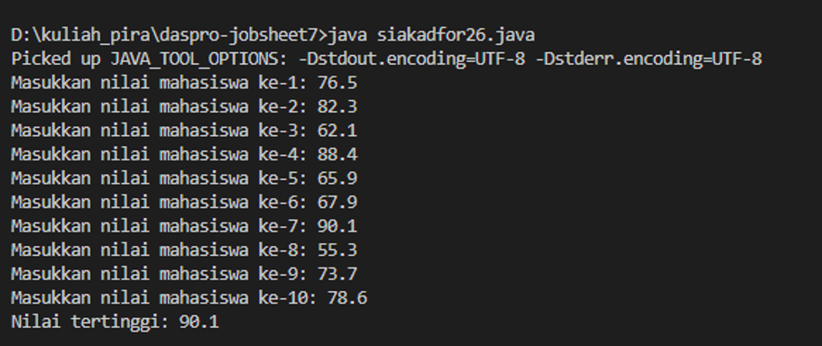
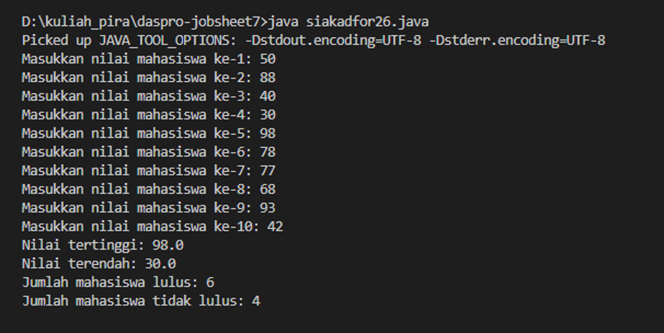
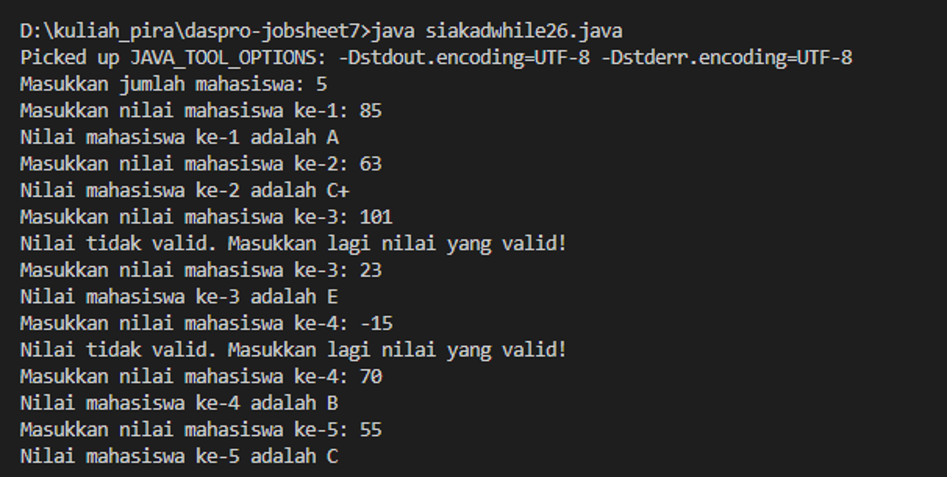
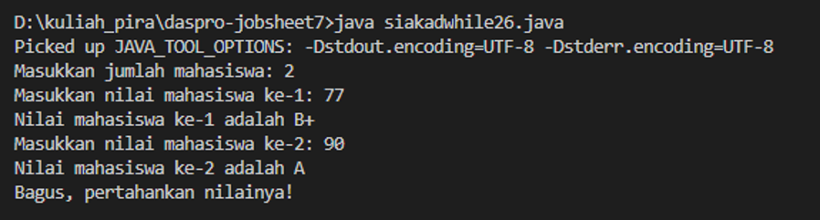
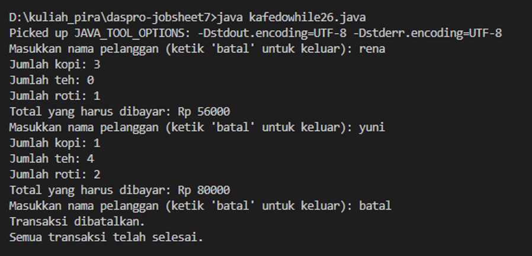
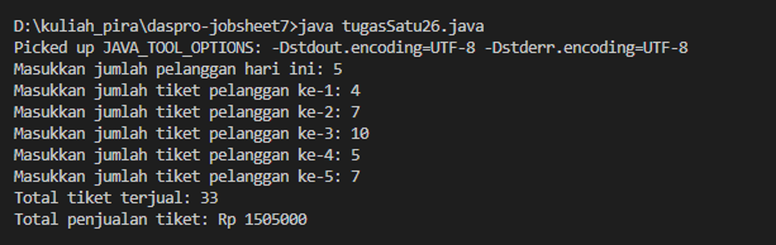
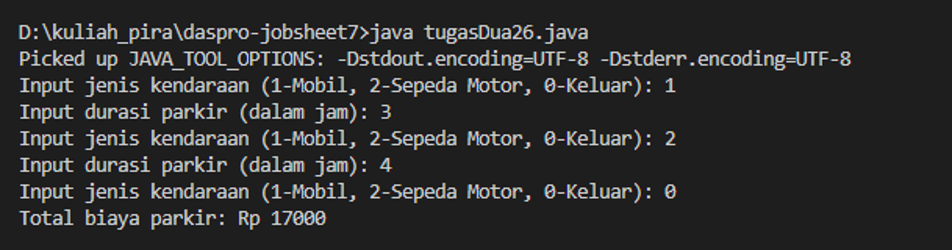

# JOBSHEET 7 - PERULANGAN 1

**Identitas Mahasiswa:**
* **Nama:** Saefira Bahari
* **NIM:** 264107020247
* **Kelas / No. Presensi:** TI-1D/26

---

## 1: TUJUAN PRAKTIKUM

Berikut adalah tujuan pelaksanaan praktikum pada bab ini:

1. Mahasiswa dapat menjelaskan format penulisan program perulangan `for`, `while`, dan `do-while`.
2. Mahasiswa dapat mengimplementasikan flowchart perulangan menggunakan bahasa pemrograman Java.

---

## 2: HASIL PERCOBAAN & ANALISIS

### 2.1 Percobaan 1: Studi Kasus Nilai Mahasiswa di SIAKAD - Perulangan FOR

Percobaan ini menggunakan perulangan `for` untuk menerima nilai dari 10 mahasiswa. Program membandingkan setiap nilai dengan nilai tertinggi dan terendah yang telah ditemukan. Program juga menghitung jumlah mahasiswa yang lulus dan tidak lulus berdasarkan batas nilai 60.

#### 2.1.1 Kode Program Java

```java
import java.util.Scanner;

public class siakadfor26 {
    public static void main(String[] args) {
        Scanner sc = new Scanner(System.in);
        double nilai, tertinggi=0, terendah=100;
        int lulus=0, tidakLulus=0;

        for (int i=1; i<=10; i++){
            System.out.print("Masukkan nilai mahasiswa ke-"+i+ ": ");
            nilai = sc.nextDouble();
            if (nilai > tertinggi){
                tertinggi = nilai;
            }
            if (nilai < terendah){
                terendah = nilai;
            }
            if (nilai >= 60){
                lulus++;
            } else {
                tidakLulus++;
            }
        }
        System.out.println("Nilai tertinggi: " +tertinggi);
        System.out.println("Nilai terendah: "+terendah);
        System.out.println("Jumlah mahasiswa lulus: "+lulus);
        System.out.println("Jumlah mahasiswa tidak lulus: "+tidakLulus);
    }
}
```

#### 2.1.2 Hasil Running / Screenshot Output

Hasil running sebelum penambahan perhitungan kelulusan menampilkan nilai tertinggi:



Setelah program dimodifikasi, hasilnya juga menampilkan nilai terendah dan jumlah mahasiswa yang lulus maupun tidak lulus:



#### 2.1.3 Jawaban Pertanyaan / Pertanyaan Refleksi

* **Pertanyaan 1:** Sebutkan dan tunjukkan masing-masing komponen perulangan `for` pada kode program Percobaan 1!  
  * **Jawab:** Komponen perulangan `for` adalah:
    1. Inisialisasi: `int i = 1`, menentukan nilai awal variabel pencacah.
    2. Kondisi: `i <= 10`, membuat perulangan berlangsung selama `i` kurang dari atau sama dengan 10.
    3. Increment: `i++`, menaikkan nilai `i` satu angka setelah setiap iterasi.
* **Pertanyaan 2:** Mengapa variabel `tertinggi` diinisialisasi 0 dan `terendah` diinisialisasi 100? Apa yang terjadi jika nilainya dibalik?  
  * **Jawab:** Nilai 0 digunakan sebagai nilai awal `tertinggi` karena nilai mahasiswa setidaknya 0, sehingga nilai yang dimasukkan dapat menggantikannya jika lebih besar. Nilai 100 digunakan sebagai nilai awal `terendah` karena nilai maksimal adalah 100, sehingga nilai yang dimasukkan dapat menggantikannya jika lebih kecil. Jika inisialisasinya dibalik, hasil dapat keliru: nilai tertinggi mungkin tetap 100 dan nilai terendah mungkin tetap 0 apabila tidak ada nilai yang melampaui nilai awal tersebut.
* **Pertanyaan 3:** Jelaskan fungsi dan alur kerja potongan kode untuk mencari nilai tertinggi dan terendah!  
  * **Jawab:** Kondisi `if (nilai > tertinggi)` mengganti nilai `tertinggi` dengan nilai masukan yang lebih besar. Kondisi `if (nilai < terendah)` mengganti nilai `terendah` dengan nilai masukan yang lebih kecil. Perbandingan dilakukan untuk setiap nilai yang dimasukkan.
* **Pertanyaan 4:** Bagaimana modifikasi program untuk menghitung mahasiswa lulus dan tidak lulus?  
  * **Jawab:** Program membandingkan setiap nilai dengan batas kelulusan 60. Jika `nilai >= 60`, penghitung `lulus` ditambah satu; jika tidak, penghitung `tidakLulus` ditambah satu. Kedua jumlah ditampilkan setelah perulangan selesai.

---

### 2.2 Percobaan 2: Studi Kasus Nilai Mahasiswa di SIAKAD - Perulangan WHILE

Percobaan ini meminta jumlah mahasiswa, lalu menerima nilai masing-masing mahasiswa. Nilai di luar rentang 0 sampai 100 ditolak dan diminta untuk dimasukkan kembali. Nilai yang valid dikategorikan ke dalam nilai huruf.

#### 2.2.1 Kode Program Java

```java
import java.util.Scanner;

public class siakadwhile26 {
    public static void main(String[] args) {
        Scanner sc = new Scanner(System.in);
        int nilai, jml, i=0;

        System.out.print("Masukkan jumlah mahasiswa: ");
        jml = sc.nextInt();

        while (i<jml){
            System.out.print("Masukkan nilai mahasiswa ke-"+ (i + 1) + ": ");
            nilai = sc.nextInt();

            if (nilai < 0 || nilai>100){
                System.out.println("Nilai tidak valid. Masukkan lagi nilai yang valid!");
                continue;
            }

            if (nilai > 80 && nilai <= 100){
                System.out.println("Nilai mahasiswa ke-"+ (i + 1 ) +" adalah A");
                System.out.println("Bagus, pertahankan nilainya!");
            } else if (nilai > 73 && nilai <= 80){
                System.out.println("Nilai mahasiswa ke-"+ (i + 1 ) +" adalah B+");
            } else if (nilai > 65 && nilai <= 73){
                System.out.println("Nilai mahasiswa ke-"+ (i + 1 ) +" adalah B");
            } else if (nilai > 60 && nilai <= 65){
                System.out.println("Nilai mahasiswa ke-"+ (i + 1 ) +" adalah C+");
            } else if (nilai >50 && nilai <= 60){
                System.out.println("Nilai mahasiswa ke-"+ (i + 1 ) +" adalah C");
            } else if (nilai > 39 && nilai <= 50){
                System.out.println("Nilai mahasiswa ke-"+ (i + 1 ) +" adalah D");
            } else {
                System.out.println("Nilai mahasiswa ke-"+ (i + 1 ) +" adalah E");
            }
            i++;
        }
    }
}
```

#### 2.2.2 Hasil Running / Screenshot Output

Gambar berikut menunjukkan validasi input tidak valid, pengulangan input untuk mahasiswa yang sama, dan penentuan kategori nilai:



Setelah ditambahkan pesan khusus untuk nilai A, hasil running-nya adalah:



#### 2.2.3 Jawaban Pertanyaan / Pertanyaan Refleksi

* **Pertanyaan 1:** Apa maksud dan kegunaan `nilai < 0 || nilai > 100`?  
  * **Jawab:** Kondisi tersebut bernilai benar apabila nilai kurang dari 0 atau lebih dari 100. Nilai seperti itu tidak valid dan program meminta input ulang.
* **Pertanyaan 2:** Apa fungsi `continue`?  
  * **Jawab:** `continue` melewati sisa perintah pada iterasi saat ini dan melanjutkan ke iterasi berikutnya. Dalam program ini, kategori nilai dan `i++` dilewati ketika input tidak valid, sehingga nilai diminta kembali untuk mahasiswa yang sama.
* **Pertanyaan 3:** Mengapa `i++` dituliskan di akhir perulangan `while`? Apa yang terjadi jika dituliskan di awal?  
  * **Jawab:** `i++` diletakkan setelah nilai valid berhasil diproses agar nomor mahasiswa bertambah satu setelah satu mahasiswa selesai. Jika diletakkan di awal, pencacah bertambah sebelum nilai diproses sehingga nomor mahasiswa dapat bergeser dan input pertama tidak lagi diproses dengan nomor yang diharapkan.
* **Pertanyaan 4:** Apabila jumlah mahasiswa yang dimasukkan adalah 19, berapa kali perulangan `while` berjalan?  
  * **Jawab:** Nilai valid diproses sebanyak 19 kali. Jika ada input tidak valid, iterasi input berjalan lebih dari 19 kali karena input tersebut tidak menaikkan pencacah mahasiswa.
* **Pertanyaan 5:** Bagaimana menampilkan pesan tambahan ketika mahasiswa mendapat nilai A?  
  * **Jawab:** Pesan `"Bagus, pertahankan nilainya!"` ditambahkan di dalam cabang kondisi nilai A. Dengan demikian, pesan hanya ditampilkan ketika nilai berada pada rentang lebih dari 80 hingga 100.

---

### 2.3 Percobaan 3: Studi Kasus Transaksi di Kafe - Perulangan DO-WHILE

Percobaan ini memproses transaksi pelanggan berulang kali. Program menghitung total harga kopi, teh, dan roti berdasarkan jumlah yang dibeli. Transaksi dihentikan apabila pelanggan memasukkan nama `batal`.

#### 2.3.1 Kode Program Java

```java
import java.util.Scanner;
public class kafedowhile26 {
    public static void main(String[] args) {
        Scanner sc = new Scanner(System.in);
        int kopi, teh,roti;
        String namaPelanggan;
        int hargaKopi=12000, hargaTeh=7000, hargaRoti=20000, totalHarga=0;

        do {
            System.out.print("Masukkan nama pelanggan (ketik 'batal' untuk keluar): ");
            namaPelanggan = sc.nextLine();
            if (namaPelanggan.equalsIgnoreCase("batal")) {
                System.out.println("Transaksi dibatalkan.");
                break;
            }
            System.out.print("Jumlah kopi: ");
            kopi = sc.nextInt();
            System.out.print("Jumlah teh: ");
            teh = sc.nextInt();
            System.out.print("Jumlah roti: ");
            roti = sc.nextInt();

            totalHarga = (kopi * hargaKopi) + (teh * hargaTeh) + (roti * hargaRoti);
            System.out.println("Total yang harus dibayar: Rp " + totalHarga);
            sc.nextLine();
        } while (true);
        System.out.println("Semua transaksi telah selesai.");
    }
}
```

#### 2.3.2 Hasil Running / Screenshot Output



#### 2.3.3 Jawaban Pertanyaan / Pertanyaan Refleksi

* **Pertanyaan 1:** Jika nama pelanggan yang dimasukkan pertama kali adalah `batal`, berapa kali perulangan dilakukan?  
  * **Jawab:** Satu kali. Bagian `do` dijalankan terlebih dahulu untuk meminta nama pelanggan. Setelah nama `batal` dimasukkan, `break` langsung menghentikan perulangan.
* **Pertanyaan 2:** Sebutkan kondisi berhenti yang digunakan pada perulangan tersebut!  
  * **Jawab:** Perulangan dihentikan ketika `namaPelanggan.equalsIgnoreCase("batal")` bernilai benar dan program menjalankan `break`.
* **Pertanyaan 3:** Apa fungsi penggunaan nilai `true` pada kondisi `do-while`?  
  * **Jawab:** Kondisi `while (true)` membuat perulangan terus berjalan. Perulangan berhenti ketika program menemukan nama `batal` dan menjalankan `break`.
* **Pertanyaan 4:** Mengapa perulangan `do-while` tetap berjalan meskipun tidak ada komponen inisialisasi dan update?  
  * **Jawab:** Inisialisasi dan update bukan komponen wajib pada `do-while`. Dalam program ini, kondisi selalu `true`, sehingga perulangan terus berlangsung sampai dihentikan secara eksplisit dengan `break`.

---

## 3: TUGAS MANDIRI

Berikut adalah tugas yang dikerjakan pada Jobsheet ini:

- [x] **Tugas 1:** Menghitung jumlah tiket terjual dan total penjualan tiket bioskop dengan diskon.
- [x] **Tugas 2:** Menghitung total biaya parkir beberapa kendaraan menggunakan perulangan.

### 3.1 Tugas 1: Perhitungan Penjualan Tiket Bioskop

Program menghitung total tiket dan penjualan harian. Harga tiket adalah Rp50.000 per tiket. Pembelian lebih dari 4 tiket mendapat diskon 10%, sedangkan pembelian lebih dari 10 tiket mendapat diskon 15%. Jumlah tiket negatif ditolak dan diminta kembali.

#### 3.1.1 Kode Program Java

```java
import java.util.Scanner;

public class tugasSatu26{
    public static void main(String[] args) {
        Scanner sc = new Scanner(System.in);
        int hargaTiket = 50000;
        int jumlahPelanggan, jumlahTiket;
        int totalTiket = 0;
        double totalPenjualan = 0;

        System.out.print("Masukkan jumlah pelanggan hari ini: ");
        jumlahPelanggan = sc.nextInt();

        for (int i = 1; i <= jumlahPelanggan; i++) {
            do {
                System.out.print("Masukkan jumlah tiket pelanggan ke-" + i + ": ");
                jumlahTiket = sc.nextInt();

                if (jumlahTiket < 0) {
                    System.out.println("Jumlah tiket tidak valid. Masukkan ulang.");
                }
            } while (jumlahTiket < 0);

            double diskon = 0;
            if (jumlahTiket > 10) {
                diskon = 0.15;
            } else if (jumlahTiket > 4) {
                diskon = 0.10;
            }

            totalTiket += jumlahTiket;
            totalPenjualan += jumlahTiket * hargaTiket * (1 - diskon);
        }

        System.out.println("Total tiket terjual: " + totalTiket);
        System.out.println("Total penjualan tiket: Rp " + (long) totalPenjualan);
    }
}
```

#### 3.1.2 Hasil Running / Screenshot Output



#### 3.1.3 Analisis

Perulangan `for` memproses setiap pelanggan. Di dalamnya, `do-while` meminta ulang jumlah tiket selama nilainya negatif. Program memilih diskon 15% untuk pembelian lebih dari 10 tiket, 10% untuk pembelian lebih dari 4 sampai dengan 10 tiket, dan tanpa diskon untuk pembelian 4 tiket atau kurang. Hasil pada screenshot menunjukkan total 33 tiket dan penjualan sebesar Rp1.505.000.

### 3.2 Tugas 2: Perhitungan Biaya Parkir

Program menghitung total biaya parkir untuk beberapa kendaraan. Tarif mobil adalah Rp3.000 per jam dan tarif sepeda motor Rp2.000 per jam. Input jenis kendaraan `0` digunakan untuk mengakhiri pencatatan.

#### 3.2.1 Kode Program Java

```java
import java.util.Scanner;
public class tugasDua26 {
    public static void main(String[] args) {
        Scanner sc = new Scanner(System.in);
        int jenis, durasi, total=0;

        System.out.print("Input jenis kendaraan (1-Mobil, 2-Sepeda Motor, 0-Keluar): ");
        jenis = sc.nextInt();

        while (jenis != 0){
            if(jenis == 1|| jenis == 2){
                System.out.print("Input durasi parkir (dalam jam): ");
                durasi = sc.nextInt();

                if(jenis == 1){
                    total += durasi * 3000;
                } else {
                    total += durasi * 2000;
                }
            }
            System.out.print("Input jenis kendaraan (1-Mobil, 2-Sepeda Motor, 0-Keluar): ");
            jenis = sc.nextInt();
        }
        System.out.println("Total biaya parkir: Rp " + total);
    }
}
```

#### 3.2.2 Hasil Running / Screenshot Output



#### 3.2.3 Analisis

Perulangan `while` terus meminta jenis kendaraan selama input bukan `0`. Untuk mobil, biaya dihitung dari durasi dikalikan Rp3.000 per jam; untuk sepeda motor, durasi dikalikan Rp2.000 per jam. Pada contoh di screenshot, biaya parkir mobil selama 3 jam dan motor selama 4 jam berjumlah Rp17.000.

---

## 4: KESIMPULAN

Perulangan membantu menjalankan instruksi berulang sesuai jumlah data atau kondisi tertentu. Perulangan `for` sesuai digunakan ketika jumlah pengulangan diketahui, seperti memproses nilai 10 mahasiswa. Perulangan `while` memeriksa kondisi sebelum setiap iterasi dan dapat digunakan bersama validasi serta `continue` untuk mengulang input yang tidak valid. Perulangan `do-while` menjalankan isi perulangan setidaknya satu kali; pada program transaksi kafe, `while (true)` menjaga transaksi tetap berjalan sampai pelanggan memasukkan `batal` dan program menjalankan `break`. Kedua tugas mandiri juga menunjukkan penggunaan perulangan untuk memproses transaksi tiket dan biaya parkir sampai seluruh data selesai dimasukkan.
